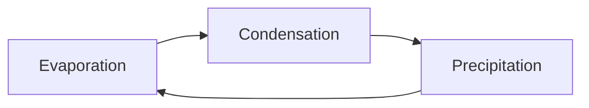

# Flashcards

Flashcards is a web app for studying flashcard decks that you write in Markdown. You can install it on Windows, macOS, iOS, and iPadOS, and it works offline after the first visit. The app is a Progressive Web App (PWA), which is a website that installs like an app.

The app is at <https://kspeeckaert.github.io/flashcards/flashcards.html>.

## Install the app

Open the app address in a browser once while you are online. Then install it:

- Windows: in Microsoft Edge or Google Chrome, click the install icon in the address bar, or open the browser menu and select "Install Flashcards".
- macOS: in Safari, select File > Add to Dock. In Google Chrome, click the install icon in the address bar.
- iPhone and iPad: in Safari, tap the Share button and then tap "Add to Home Screen".

The app opens in its own window. To use the app without a network connection, open it once while you are online. The app then stores all its files on the device.

## Updates

If a new version is available, the app shows the message "A new version is available." with a Reload button. Click Reload to start the new version. The app does not reload on its own, so a study session is not interrupted.

The app looks for a new version each time you open it while you are online.

## Load a deck

1. Click "Choose file…", or drag a `.md` file onto the drop area.
2. Select the sections that you want to study.
3. Set the options: shuffle, reverse (answer becomes question), and save.
4. Click "Study →".

If you turn on "Save this deck", the app keeps the deck in the storage of the browser. Saved decks show on the start screen. To delete a saved deck, swipe it to the left on a touch screen, or click the trash icon on a desktop.

Saved decks stay on one device and in one browser. They do not synchronize. Keep your `.md` files as the original copy.

## Controls

| Action | Input |
|---|---|
| Show the answer | Click or tap the card, or press Space. If the card has the keyboard focus, Enter also works. |
| Mark as correct | Press the Right arrow, swipe right, or click "Got it" |
| Mark as incorrect | Press the Left arrow, swipe left, or click "Miss" |
| Undo the last answer | Click "Undo" (top left) |

You can use the app with the keyboard only. Press Tab to move between the controls. Press Space or Enter to select a section, to change a switch, or to open a saved deck. When a study session starts, the card has the keyboard focus. If a button has the focus, Space and Enter operate that button.

After the last card, you can study the deck again, study only the cards that you missed, change the sections, or load a different deck.

## Card format

A deck is a Markdown file:

```md
# My Japanese Deck

## Chapter 1: Greetings

### こんにちは
hello

### さようなら
goodbye

## Chapter 2: Food & Drink

### What does this kanji mean?
食

---

food, to eat
```

The app reads the file as follows:

- `#`: the name of the deck.
- `##`: the start of a section.
- `###`: the front of a card (the question).
- The lines below a `###` heading: the back of the card (the answer).
- A line with only `---` in a card: the end of the front. The lines between the `###` heading and `---` belong to the front, and the lines after `---` belong to the back.

If a card has no `---` line, all lines below the heading belong to the back. Put a blank line before `---`. Without it, other Markdown tools show the line above `---` as a heading. A card uses only its first `---` line as the separator.

Both sides support Markdown, for example bold, italic, code, and lists. If a card has no answer, the app skips it and shows a warning. The app ignores headings with `####` or more and shows a warning. Inside a code block (between ```` ``` ```` lines), the app does not read `#` or `---` lines as headings or separators.

### Math

The app shows math with KaTeX:

- Inline math: `$E = mc^2$`
- Display math: `$$\int_{-\infty}^{\infty} e^{-x^2}\, dx = \sqrt{\pi}$$`, or `$$` on its own line before and after the formula

For inline math, put the opening `$` at the start of a line or after a space. Put a space, a punctuation mark (`.,:?!`), or the end of the line after the closing `$`. Thus "It costs $5 and $10." stays text. Math directly inside brackets, for example `($x$)`, also stays text. Write `( $x$ )` instead.

If a formula has an error, the app shows the formula source in red.

### Images and diagrams

Each side of a card can show one image or one diagram. The app shows it below the answer buttons, outside the card:

- Before you flip the card, the app shows the image or diagram of the front.
- After you flip the card, the app shows the image or diagram of the back.
- If the visible side has no image or diagram, the app shows nothing below the buttons.

If a side has an image or a diagram but no text, the card shows "see image" or "see diagram". In reverse mode, the front and the back change places, together with their images and diagrams.

If a side has more than one image or diagram, the app uses the first one and shows a warning.

### Images

A deck contains its images as base64 data, so the deck stays one file. The app supports PNG, JPEG, WebP, GIF, and SVG. The deck uses standard Markdown reference images: `![description][key]` in the card, and a definition line `[key]: data:image/...` at the end of the file.

1. Open the Image → Markdown tool. The start screen of the app has a link to it.
2. Drop your image files on the tool, or click "Choose images…".
3. Set a short key and a description for each image. The tool shows how much space each image takes in the deck, and the total.
4. Copy the image definitions, and paste them at the end of your `.md` file.
5. Copy the line `![description][key]` of an image, and paste it in the front or the back of a card.

Example:

```md
### Which bird is this?
![A small bird with a red chest][robin]

---

European robin

[robin]: data:image/png;base64,...
```

The tool makes images smaller before it adds them to the deck:

- It scales an image down until its longest side is at most 1200 pixels.
- It stores a photo as JPEG. It keeps line art and images with transparent areas as PNG, because JPEG blurs sharp edges and has no transparency.
- It keeps SVG and GIF files as they are. A GIF can be animated.
- If the original file is smaller than the result, it keeps the original file.

Rules for images:

- The key is not case-sensitive. `[Robin]` and `[robin]` are the same key.
- The app also reads `![robin][]`, `![robin]`, and ``.
- The app shows only `data:image/...` images, because it must work offline. For an image from a web address, the app shows a warning.
- If a key has no definition, or a definition is not used, the app shows a warning.

Decks from version 1.43 and earlier use `<!-- img:key -->` and an `images:` block at the top of the file. The app does not read that format and shows a warning. To convert such a deck, make the image definitions again with the Image → Markdown tool.

### Diagrams

A diagram is a Mermaid code block:

````md
### Draw the water cycle

---


````

The app draws the diagram with Mermaid (<https://mermaid.js.org>). The diagram scales down to the width of the screen. If the code of a diagram has an error, the app shows the message "This diagram has an error. Its source:" and the code.

The app loads Mermaid the first time that it shows a diagram. Mermaid is stored with the other files of the app, so diagrams also show offline.

## Browser support

The app works in current versions of Safari, Chrome, Edge, and Firefox on desktop computers, phones, and tablets.

## Development

The app has no build step for the code. The HTML, CSS, and JavaScript files run as they are. A small build script only copies the libraries and writes the file list for offline use. The section "Build script" explains it.

### Run the app on your computer

1. Open a terminal in the folder of the repository.
2. Start a web server:

   ```sh
   python3 -m http.server 8080
   ```

3. Open <http://localhost:8080/flashcards.html> in a browser.

On `localhost` and `127.0.0.1`, the app does not start its service worker (the script that stores the files for offline use). Thus your changes show after a normal reload. To test offline use on your computer, open <http://localhost:8080/flashcards.html?sw>.

### Build script

The script `scripts/build.js` does three tasks:

1. It copies the browser libraries (marked, DOMPurify, KaTeX, marked-katex-extension, Mermaid) and the fonts (Lora, DM Sans) from `node_modules/` into `vendor/`.
2. It writes `vendor/fonts/fonts.css` for those fonts.
3. It writes a block into `sw.js`. The block contains the app version, the list of files for offline use, and a hash of their contents.

The app needs `vendor/` because it must work offline. It does not load files from other websites. The service worker needs the file list because it downloads only the files on that list. If a file is missing from the list, the app breaks when the device is offline.

The hash is necessary for updates. Installed apps look for a new version of `sw.js` only. If any file of the app changes, the hash in `sw.js` changes. The installed apps then download the new files.

You need Bun (<https://bun.sh>) to run the script. Node.js also works: `node scripts/build.js`.

Run the build script in these cases:

- After you change, add, or remove a file in `css/`, `js/`, `img/`, or in one of the HTML pages.
- After you change `js/version.js`.
- After you change the version of a library in `package.json`.

If you forget to run it, installed apps do not get your change.

To run the build script:

1. If `node_modules/` does not exist, or if `package.json` changed, run `bun install`.
2. Run `bun run build`.
3. Commit the changes in `vendor/` and `sw.js` together with your own changes.

The command `bun run check` tells you whether the build is up to date. The command changes nothing. If `vendor/` or `sw.js` is out of date, the command shows the files and stops with exit code 1. You can use it in a Git pre-commit hook.

Do not edit `vendor/` or the block between `// BEGIN PRECACHE` and `// END PRECACHE` in `sw.js` by hand. The build script replaces them.

### Update a library

1. Change the version number in `package.json`.
2. Run `bun install`.
3. Run `bun run build`.
4. Test the app, and commit `package.json`, `bun.lock`, `vendor/`, and `sw.js`.

### Version number

The version has the format `<major>.<minor>.<YYYYMMDD>`, for example `1.42.20261010`. Change it in `js/version.js` for each change, and then run `bun run build`. The footer of both pages shows the version.

### App icons

The source of the app icon is `img/icon.svg`. The PNG files in `img/icons/` come from that file. If you change `img/icon.svg`, make the PNG files again, for example with `rsvg-convert` from the `librsvg` package (`brew install librsvg`):

```sh
rsvg-convert -w 192 -h 192 img/icon.svg -o img/icons/icon-192.png
rsvg-convert -w 512 -h 512 img/icon.svg -o img/icons/icon-512.png
rsvg-convert -w 180 -h 180 img/icon.svg -o img/icons/apple-touch-icon.png
```

Then run `bun run build`.

### Files

| Path | Content |
|---|---|
| `flashcards.html` | The app |
| `img-to-md.html` | The Image → Markdown tool |
| `css/`, `js/` | The styles and the code of both pages |
| `js/version.js` | The app version |
| `js/pwa.js` | Service worker registration, update message, version footer |
| `sw.js` | The service worker |
| `manifest.webmanifest` | The name, the icons, and the colors for the installed app |
| `img/` | Icons and images |
| `vendor/` | Libraries and fonts, written by the build script |
| `scripts/build.js` | The build script |
| `sample.md` | An example deck |
